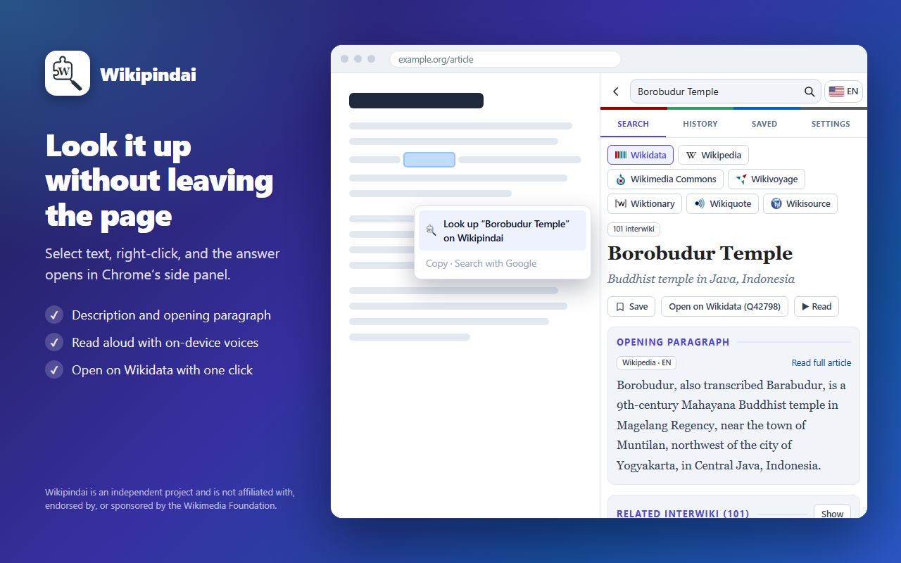

# Wikipindai

[Bahasa Indonesia](#bahasa-indonesia) · [English](#english)

Ekstensi Chrome (Manifest V3) untuk mencari teks terpilih di proyek Wikimedia lewat panel samping.
Tanpa AI, tanpa pelacakan, tanpa server sendiri. · A Chrome (Manifest V3) extension that looks up selected
text on Wikimedia projects in a side panel. No AI, no tracking, no server of its own.

[](https://affandymurad.github.io/wikipindai/)

- Chrome Web Store: <https://chromewebstore.google.com/detail/wikipindai/glcobijbpcbmoafkildiogicojdbdnkg?utm_source=item-share-cb>
- Halaman proyek / Project page: <https://affandymurad.github.io/wikipindai/>
- Kebijakan privasi / Privacy policy: <https://affandymurad.github.io/wikipindai/privacy.html>
- Dibuat oleh / Made by [Affandy Murad](https://meta.wikimedia.org/wiki/User:Affandy_Murad)

> **Pernyataan:** Wikipindai adalah proyek independen dan tidak berafiliasi dengan, didukung, atau
> disponsori oleh Wikimedia Foundation. Wikipedia, Wikidata, Wikimedia Commons, dan nama proyek lainnya
> adalah merek dagang Wikimedia Foundation.
>
> *Wikipindai is an independent project and is not affiliated with, endorsed by, or sponsored by the
> Wikimedia Foundation. Wikipedia, Wikidata, Wikimedia Commons and the other project names are
> trademarks of the Wikimedia Foundation.*

## Bahasa Indonesia

### Pasang (mode pengembang)

1. Unduh atau kloning repositori ini (atau pakai ZIP dari halaman proyek).
2. Buka `chrome://extensions`, aktifkan **Mode pengembang**.
3. Klik **Muat yang belum dipaketkan** dan pilih folder repositori (yang berisi `manifest.json`).
4. Sematkan ikonnya di toolbar (opsional). Perlu Chrome 116 atau lebih baru.

### Cara pakai

- Blok teks (paling banyak 5 kata) di halaman mana pun, klik kanan, pilih **Cari "…" di Wikipindai**.
  Pilihan yang lebih panjang hanya menampilkan pesan di panel, tidak mencari.
- Atau klik ikon ekstensi lalu cari manual di panel.
- Chip mode di atas hasil: Wikidata (bawaan), Wikipedia, Wikimedia Commons, Wikivoyage, Wiktionary,
  Wikiquote, Wikisource. Mengganti chip langsung mencari kata yang sama; kolom kosong menampilkan
  penjelasan fungsi mode itu. Hasil memakai paginasi 10 per halaman dengan jumlah halaman.
- Hasil Commons menampilkan thumbnail. Tiap hasil bisa diklik untuk membuka halamannya langsung, atau
  disimpan dengan bookmark. Khusus Wikidata, klik membuka detail di panel: deskripsi, paragraf pembuka
  Wikipedia (sesuai bahasa antarmuka), tombol baca (suara perangkat), dan direktori interwiki
  (filter proyek, cari, 12 per halaman).
- Tab: Cari, Riwayat (dikelompokkan per tanggal, lengkap dengan jam), Tersimpan (dikelompokkan per
  proyek, ekspor/impor JSON), Pengaturan (tema, riwayat, tautan alat-alat Affandy Murad).
- Mengganti bahasa antarmuka mencari ulang hasil yang sedang tampil di edisi bahasa yang baru.
- Panel bisa dipakai pada lebar sempit; deretan tab bergeser horizontal bila labelnya panjang.

### Format ekspor/impor

Tombol Ekspor mengunduh `Wikipindai-saved-TANGGAL.json`. Impor menerima berkas itu, atau daftar
sederhana seperti berikut. Item yang sudah ada dilewati.

```json
{
  "saved": [
    { "project": "wikidata", "id": "Q42", "title": "Douglas Adams" },
    { "project": "wikipedia", "lang": "id", "title": "Borobudur" }
  ]
}
```

`project` salah satu dari `wikidata`, `wikipedia`, `commons`, `wikivoyage`, `wiktionary`, `wikiquote`,
`wikisource`. `lang` wajib untuk proyek per bahasa (bukan Wikidata dan Commons); `id` (nomor Q) wajib
untuk Wikidata. URL thumbnail yang diimpor hanya diterima bila berasal dari server Wikimedia.

## English

### Install (developer mode)

1. Download or clone this repository (or use the ZIP from the project page).
2. Open `chrome://extensions` and turn on **Developer mode**.
3. Click **Load unpacked** and choose the repository folder (the one containing `manifest.json`).
4. Pin the icon to the toolbar (optional). Requires Chrome 116 or newer.

### Usage

- Select text (up to 5 words) on any page, right-click and choose **Look up "…" on Wikipindai**. A longer
  selection only shows a message in the panel. Or click the toolbar icon and type a search.
- Pick a project with the mode chips: Wikidata (default), Wikipedia, Wikimedia Commons, Wikivoyage,
  Wiktionary, Wikiquote or Wikisource. Switching searches the same word again; an empty box explains what
  each mode is for. Results are paginated (10 per page) with a page count.
- Commons results show thumbnails. Each result opens its page directly or can be bookmarked. For Wikidata,
  a click opens a detail view: description, the opening paragraph from Wikipedia in the interface language,
  a read-aloud button (on-device voices) and an interwiki directory (project filters, search, 12 per page).
- Tabs: Search, History (grouped by date and time), Saved (grouped by project, JSON export/import) and
  Settings (theme, history, links to Affandy Murad's other tools).
- Changing the interface language searches again in that language's edition.

### Export / import format

Export downloads `Wikipindai-saved-DATE.json`. Import accepts that file or a simple list like the one in
the Indonesian section above. Items you already have are skipped. `project` is one of `wikidata`,
`wikipedia`, `commons`, `wikivoyage`, `wiktionary`, `wikiquote`, `wikisource`; `lang` is required for
per-language projects (not Wikidata or Commons); `id` (the Q number) is required for Wikidata. Imported
thumbnail URLs are accepted only from Wikimedia servers.

## Pengembangan / Development

Tidak ada langkah build untuk ekstensinya: berkasnya dimuat apa adanya. / The extension has no build
step: the files load as they are.

### Menambah bahasa / Adding a language

Semua bahasa didefinisikan di `languages.js`. Kunci objek adalah kode bahasa Wikimedia (mis. `jv`, `su`)
dan sekaligus menentukan edisi proyek (`https://<kode>.wikipedia.org`, dst.) serta bahasa antarmuka.
Tambahkan satu entri dengan `name`, `flag` dan `dir`, lalu isi teksnya di `translations.js`; teks yang belum
diterjemahkan otomatis memakai bahasa Inggris. Tambahkan juga bendera di `flags/<kode>.svg`. / Every language
is defined in `languages.js`; the key is the Wikimedia language code and also picks the project edition. Add
an entry with `name`, `flag` and `dir`, fill in the strings in `translations.js` (missing ones fall back to
English) and add `flags/<code>.svg`.

### Bahan toko dan paket / Store assets and package

Perlu Node.js, Windows PowerShell, Chrome atau Edge, dan koneksi internet (panel mengambil data langsung
dari Wikimedia). / Needs Node.js, Windows PowerShell, Chrome or Edge and an internet connection.

```bash
npm run icons       # ikon ekstensi dan ikon toko dari store/build/icon.svg
npm run shots       # 5 screenshot x 2 bahasa (1280x800)
npm run tiles       # promo tile 440x280 dan marquee 1400x560
npm run zip         # dist/wikipindai-<versi>.zip untuk Chrome Web Store
```

Teks listing, isian tab Privacy, dan kategori ada di [`store/LISTING.md`](store/LISTING.md) dan
[`store/PRIVACY_FORM.md`](store/PRIVACY_FORM.md).

## Berkas / Files

| Berkas / File | Fungsi / Purpose |
| --- | --- |
| `manifest.json` | Konfigurasi, izin / configuration, permissions (`sidePanel`, `contextMenus`, `storage`) |
| `background.js` | Menu klik kanan, membuka panel samping / context menu, opens the side panel |
| `sidepanel.html/css/js` | Antarmuka panel / panel UI: search, modes, Wikidata detail, history, saved |
| `languages.js` | Registri bahasa dan teks Inggris/Indonesia / language registry and English/Indonesian strings |
| `translations.js` | Terjemahan 13 bahasa lain dan teks tambahan / the other 13 languages and extra strings |
| `_locales/` | Nama dan deskripsi ekstensi / extension name and description (en, id) |
| `icons/`, `flags/`, `tools/` | Ikon ekstensi, bendera pemilih bahasa, ikon alat / extension icons, language flags, tool icon |
| `LICENSE` | MIT untuk kode Wikipindai / MIT for the Wikipindai code |
| `PRIVACY.md` | Kebijakan privasi / privacy policy |
| `store/` | Bahan Chrome Web Store dan skrip pembuatnya / Web Store material and the scripts that build it |

## Bahasa antarmuka / Interface languages

English, Bahasa Indonesia, Bahasa Melayu, 한국어, Español, Français, Deutsch, 日本語, 中文, العربية,
Nederlands, Русский, ไทย, தமிழ், עברית. Arab dan Ibrani tampil dari kanan ke kiri. / Arabic and Hebrew are
shown right to left.

## Lisensi dan atribusi / License and attribution

- **Kode / Code:** [MIT](LICENSE), © 2026 Affandy Murad.
- **Konten yang ditampilkan / Displayed content:** berasal dari proyek Wikimedia dan tetap memakai lisensinya
  sendiri. Teks Wikipedia, Wikidata (CC0), dan sebagian besar proyek saudaranya tersedia dengan lisensi bebas
  seperti CC BY-SA 4.0; setiap berkas di Wikimedia Commons punya lisensi dan atribusinya sendiri. Wikipindai
  hanya menampilkan cuplikan dan tautan ke halaman aslinya; pemakaian ulang di luar ekstensi mengikuti
  lisensi masing-masing. / It comes from Wikimedia projects and keeps its own licenses (for example
  CC BY-SA 4.0; Wikidata is CC0; each file on Commons has its own license). Wikipindai shows excerpts and
  links to the original pages.
- **Ikon proyek / Project icons** pada chip dimuat langsung dari situs Wikimedia (`favicon.ico`) dan tidak
  disertakan dalam paket. / The chip icons are loaded from the Wikimedia sites themselves and are not bundled.
